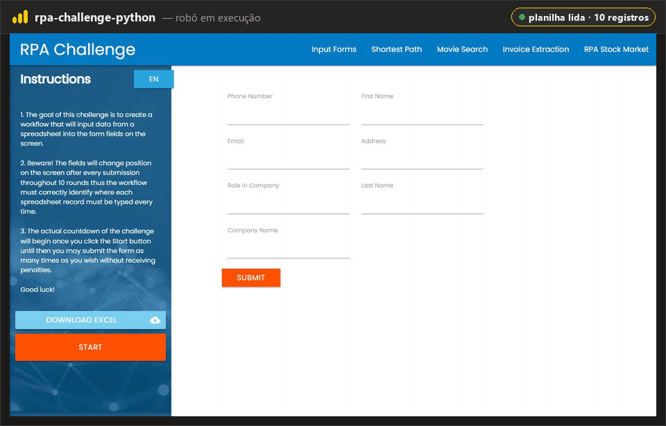

# 🤖 RPA Challenge · Python + Playwright

Robô que resolve o [RPA Challenge](https://rpachallenge.com/) — o desafio clássico de automação em que
10 formulários precisam ser preenchidos a partir de uma planilha Excel, **com os campos trocando de
posição a cada envio**.

<p align="center">
  
</p>

| Resultado | |
|---|---|
| Taxa de acerto | **100%** (70 de 70 campos) |
| Tempo medido pelo site | **~0,7 s** no modo normal |
| Execução | headless, local ou no GitHub Actions |

## Como funciona

1. Abre o site e **baixa a planilha** pelo próprio botão "Download Excel" (como um usuário faria).
2. Lê os registros com `openpyxl`, normalizando cabeçalhos (a planilha original tem espaço sobrando em `Last Name `).
3. Clica em **Start** e, para cada registro, preenche os 7 campos **pelo nome lógico do campo**
   (`ng-reflect-name`), nunca pela posição ou pelo `id`, que mudam a cada rodada.
4. Lê a mensagem final, extrai taxa de acerto, campos certos e tempo, e grava `saida/resultado.json` + print.

```text
23:38:27 INFO rodada 10/10 enviada (Lara Palmer)
23:38:27 INFO resultado: Your success rate is 100% ( 70 out of 70 fields) in 664 milliseconds
```

## Rodando

```bash
pip install -r requirements.txt
playwright install chromium
python robo.py            # headless
python robo.py --visivel  # vendo o navegador
python robo.py --demo     # salva um quadro por campo (usado para gerar o GIF)
```

## Estrutura

```text
robo.py                  # robô (download, leitura, preenchimento, resultado)
tests/test_planilha.py   # testes da leitura da planilha
.github/workflows/       # execução agendada no GitHub Actions
```

## Stack

Python · Playwright · openpyxl · pytest · GitHub Actions
